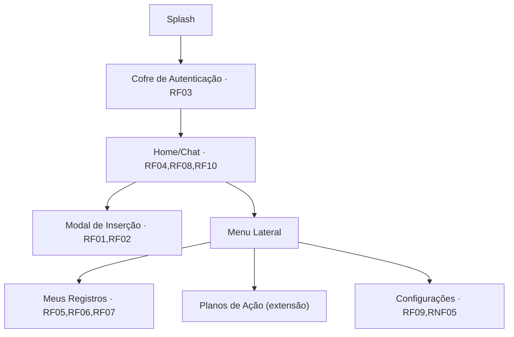

# Cerne — Documentação Consolidada do Projeto
### TCC Wagner Duarte · Contexto de referência para o agente Claude Code
**Consolidado em:** 01/09/2026 · **Baseado em:** `Requisitos_e_Fluxo_de_Telas_TCC.md` + `Plano_Backend_Cerne_v4.md` (31/08/2026)

---

## 0. Como usar este documento

Este arquivo existe para dar ao Claude Code, em qualquer um dos dois ciclos de desenvolvimento (Spec Kit ou BMAD-METHOD), o contexto completo do projeto sem precisar reconstruir decisões já fechadas. Ele **consolida e reconcilia** dois documentos-fonte que, isoladamente, contêm pequenas inconsistências de versão entre si (ex: o inventário original de endpoints do documento de requisitos foi parcialmente superado pelas decisões do plano de backend). Onde houver conflito, **este documento aplica a versão mais recente (Plano_Backend_Cerne_v4.md, 31/08/2026)** e sinaliza explicitamente o que foi substituído.

**Regra de ouro para o agente:** nenhuma decisão listada na Seção 4 (D1–D18) deve ser reaberta durante a implementação. Se uma parecer errada na prática, isso é assunto para a seção "Ameaças à Validade" da monografia — não para uma mudança de rota no código.

**Regra de ouro sobre os PDFs do projeto:** a proposta assinada, o Documento de Visão Geral e a Monografia Inicial descrevem um estágio **anterior** do projeto (comparação RIPER vs. Spec-Kit, framing de "ecossistema de saúde mental" com eficácia clínica). Esse framing **não é mais o escopo atual** — ver Seção 16 para o detalhamento da divergência. Este documento e os dois arquivos-fonte técnicos (`Requisitos_e_Fluxo_de_Telas_TCC.md` e `Plano_Backend_Cerne_v4.md`) são a fonte de verdade para implementação.

---

## 1. Contexto e pergunta de pesquisa

**Pergunta de pesquisa (atual):** entre GitHub Spec Kit e BMAD-METHOD, qual metodologia de Spec-Driven Development (SDD) produz melhores resultados ao construir um app Flutter com BLoC e Clean Architecture?

O app **Cerne** — um diário reflexivo com IA — é o **veículo experimental neutro**, não o objeto de estudo. Sua "essência" de produto se mantém, mas todo o desenho de requisitos é feito pela lente de "o que gera dado comparativo entre as duas metodologias", não pela completude do produto em si.

**RIPER** foi removido da comparação e reaproveitado como a metodologia usada para construir o **backend compartilhado e congelado** — ele não é mais uma das duas variáveis comparadas.

**Três pilares de controle experimental:**
1. Um único protótipo de alta fidelidade, gerado no **Claude Design**, como referência visual congelada que os dois ciclos precisam igualar (métrica RNF08).
2. Um **backend único e compartilhado**, totalmente congelado antes de qualquer ciclo começar.
3. Os dois ciclos rodando inteiramente dentro do **Claude Code**, para eliminar troca de ferramenta como variável de confusão.

---

## 2. Estado atual do projeto (01/09/2026)

- Todas as **18 decisões de arquitetura do backend (D1–D18) estão fechadas** (Plano_Backend_Cerne_v4.md, 31/08/2026).
- O documento de requisitos está em sua versão mais recente disponível (RF01–RF10, RNF01–RNF09).
- O protótipo está **congelado**, com hash registrado (referenciado na Seção 8 do plano de backend; o valor do hash em si não está neste conjunto de documentos).
- O projeto está na **Fase 0 (Fundação)** do cronograma de backend, com prazo até 01/09.
- **Nenhuma linha de código de implementação foi escrita ainda** — nem migrações, nem endpoints.
- Meta de congelamento do backend: **23/09/2026**.

---

## 3. O produto: Cerne (visão funcional)

Diário reflexivo com IA. Captura multimodal de entradas (texto, áudio, foto), chat conversacional com memória via RAG sobre as entradas do usuário, busca semântica, exportação de resumo pessoal, insights proativos e um dashboard de evolução temporal.

**Distinção arquitetural crítica:** entradas de diário (RF01–RF10) e mensagens de chat **são conceitos separados**.
- O **Modal de Inserção (RF01)** é o único caminho de escrita direta no RAG.
- O **chat é conversacional por padrão** — não cria entradas automaticamente.
- A única ponte entre os dois é o **RF10**: um botão explícito em mensagens do usuário no chat para promovê-las a entradas, reaproveitando o mesmo pipeline de PII + embedding do RF01.

---

## 4. Requisitos Funcionais — Núcleo Comparativo (RF01–RF10)

Construídos e medidos em **ambos** os ciclos. Cada um tem uma anotação "Estressa" indicando a camada arquitetural que o requisito foi desenhado para exercitar — isso é intencional, não incidental.

| ID | Nome | Estressa | Resumo |
|---|---|---|---|
| **RF01** | Captura Multimodal | Serviços / integração de device | Texto, áudio e foto pela Tela 2 (Modal de Inserção). Toda captura vira `POST /entries` — nunca uma mensagem de chat. Cancelar a captura no meio não cria entrada parcial/vazia. |
| **RF02** | Processamento STT/OCR | Serviços / API externa | Transcrição de áudio e OCR sobre o conteúdo do RF01. Quatro estados visíveis: gravando, processando, transcrito, erro. |
| **RF03** | Cofre de Autenticação Biométrica | Serviços / segurança | Face ID / Touch ID / PIN antes de expor dados. Falha de biometria cai para PIN sem travar o usuário. Timeout de sessão em background: **5 minutos fixos**, não configurável. |
| **RF04** | Chat Interativo com Memória (RAG) | BLoC assíncrono + dados | Três estados de UI obrigatórios: streaming, erro, resposta completa. Se o streaming cair no meio, o texto parcial permanece visível com indicação de falha. Mensagens de chat não criam entradas automaticamente (exceto RF10). |
| **RF05** | Exportação de Resumo Pessoal | Serviços / permissões de sistema | *(Renomeado de "Relatórios Clínicos" — sem conotação médica/diagnóstica.)* Resumo narrativo via Claude Haiku 4.5, exportável em PDF, com opção de baixar dados brutos sem narrativa. Escopo medido: geração do job, download, tratamento de falha — nunca a qualidade do texto. Zero entradas no período → erro tratado, nunca PDF vazio. Falha na narrativa não bloqueia o download dos dados brutos. |
| **RF06** | Busca Semântica/Filtro | BLoC + dados / offline | Busca por similaridade (embeddings Voyage AI) + filtros de metadado. Encontra por significado, não só termo exato (ex: "ansiedade" encontra texto que só diz "nervosismo"). Debounce de 300ms. Filtros combinam com **E**, nunca OU. Arquitetura é cloud-only — offline permite só visualização de cache, não escrita. |
| **RF07** | Histórico Multi-fonte (Timeline) | Composição de múltiplos BLoCs | Estado depende de autenticação + sync + entradas simultaneamente. Expiração de sessão não causa crash nem perde scroll. Nenhum BLoC importa outro BLoC diretamente (checável via lint de arquitetura do RNF06). |
| **RF08** | Insights Proativos (mecanismo) | Isolamento de falha / concorrência | Escopo medido: apenas o mecanismo de disparo, nunca a qualidade do texto gerado. Gatilho: N=5 mensagens do usuário OU T=2min de inatividade — dispara exatamente uma vez por condição. Falha na geração não derruba o chat principal. |
| **RF09** | Resumos Temporais / Dashboard | Agregação + visualização | Computado sob demanda ao abrir Configurações. Renderiza corretamente em 0 / 1 / >30 entradas. Recalcula após criar/editar/apagar entrada (invalidação de cache). Texto narrativo só é checado quanto a não quebrar a UI — nunca quanto ao conteúdo. |
| **RF10** | Salvar Mensagem do Chat como Entrada | Comunicação entre features na Clean Architecture | Botão em mensagens do usuário no chat. Aciona a criação via interface/caso de uso compartilhado — **nunca** importando diretamente repositório/datasource da feature de entradas (violação conta para RNF06). Idempotente: salvar duas vezes não duplica. Falha de rede mantém o chat funcional e permite retry. Só mensagens do usuário têm o botão. |

---

## 5. Requisitos Funcionais — Extensão de Produto (fora da comparação)

Mantêm a "essência" do fluxo original e existem no protótipo, mas **não recebem implementação funcional em nenhum dos dois ciclos**. Ficam como trabalho futuro na monografia.

| Requisito original | Tratamento atual |
|---|---|
| Categorização Dinâmica (IA) | Tags manuais criadas pelo usuário (tela Meus Registros) |
| Extração Autônoma de Metas | Tela Planos de Ação — estática, sem lógica |
| Ajuste Dinâmico de Persona | Toggle cosmético simples (Configurações) |

---

## 6. Requisitos Não Funcionais

### 6.1 Núcleo mensurável (comparativos, automatizáveis)

| ID | Requisito | Ferramenta / mecânica | Meta |
|---|---|---|---|
| **RNF06** | Zero Violações de Camada | Lint de arquitetura (`clean_architecture_kit` ou `import_linter`) — domínio não importa `package:flutter` nem `data/` | 0 violações |
| **RNF07** | Cobertura Mínima de Testes | `flutter test --coverage` + `very_good_coverage`, filtrado para `lib/**/domain/**` | ≥80% |
| **RNF08** | Fidelidade Visual ao Protótipo | Rubrica de 3 pontos/tela (cor primária, tipografia, espaçamento ±4dp) + check estático de hardcodes fora de `design_tokens.dart` | Score 0–3/tela + 0 hardcodes |
| **RNF09** | Tratamento de Erro de Rede Consistente | `Either<Failure, T>` via `fpdart`; testes com `mocktail` simulando falha em 5 endpoints × 3 tipos (timeout, resposta malformada, sem conexão) | 0 assinaturas fora do padrão / 15 de 15 cenários tratados |

### 6.2 Higiene (não comparativos)

- **RNF01** — Latência de Interação: ação local <100ms na UI; chamada de rede >300ms exibe indicador de carregamento.
- **RNF02** — PII Stripping: via Claude Haiku 4.5 com saída estruturada (tool use), não NER dedicado. **Anota, nunca remove** (ver D3).
- **RNF03** — Zero Data Retention.
- **RNF04** — RLS (Row Level Security).
- **RNF05** — Hard Delete de Conta/Dados (LGPD).

**Limitação consciente e documentada:** o sistema **não** possui protocolo de detecção/resposta a sinais de risco (ideação suicida, autolesão). Como o produto não é mais enquadrado como app de saúde mental, essa ausência é uma **decisão de escopo explícita** — deve ser registrada como limitação reconhecida na monografia, não como lacuna esquecida.

---

## 7. Telas e Fluxo de Navegação

**Fundação visual:** identidade minimalista, paleta acolhedora e neutra, tipografia sans-serif legível, componentes padronizados. Esta fundação é o objeto direto do RNF08.

| Tela | Descrição | Conecta a |
|---|---|---|
| **0 — Splash** | Carregamento inicial, verifica conexão, sincroniza cache em background | RF06, RNF01 |
| **0.1 — Cofre de Autenticação** | Barreira biométrica/PIN antes do acesso | RF03 |
| **1 — Home (Chat)** | Tela principal, conversa contínua, botão "+" para entrada multimodal, botão "salvar no diário" por mensagem | RF04, RF08, RF10, RNF01, RNF09 |
| **2 — Modal de Inserção** | Overlay: texto bruto, microfone, galeria/câmera. Toda captura cria entrada, nunca mensagem de chat | RF01, RF02 |
| **3 — Menu Lateral** | Hub de navegação, histórico de sessões | Navegação pura |
| **4 — Meus Registros** | Timeline consolidada, filtros, tags manuais, exportação | RF07, RF06, RF05 |
| **5 — Planos de Ação** | Kanban estático (extensão — sem lógica funcional em nenhum ciclo) | Extensão de produto |
| **6 — Configurações e Perfil** | Dashboard de evolução, seletor de persona, apagar conta | RF09, RNF05 |

---

## 8. Arquitetura do Backend — Princípios

### 8.1 Não é um produto — é um instrumento de medição

O backend existe para que **duas construções diferentes do mesmo app possam ser comparadas de forma justa**. Tudo o que **não** é a metodologia precisa ser idêntico nas duas construções: mesmo protótipo, mesma linguagem, mesma arquitetura, mesmo ambiente, **mesmo backend**.

Por isso o backend é construído **antes**, uma única vez, e depois congelado. Nenhuma linha muda enquanto os dois ciclos rodam (exceto pela política de defeito da D16).

### 8.2 A pergunta que guiou cada decisão

> "Se os dois ciclos derem resultados diferentes, essa diferença pode ter vindo do backend?"

Sempre que a resposta foi "pode", a decisão mudou — mesmo quando isso significou mais trabalho. Isso explica escolhas aparentemente sobre-engenheiradas (ex: D2, todos os endpoints escritos à mão em vez de usar o PostgREST do Supabase).

### 8.3 O maior risco técnico: não-determinismo de IA

Modelos de IA não são determinísticos. Se o ciclo A recebeu uma resposta e o ciclo B recebeu outra, qualquer diferença medida ali está contaminada — e com uma construção por metodologia, não há tratamento estatístico que resolva. A solução é o **cache de replay** (Seção 12).

---

## 9. As 18 Decisões de Arquitetura (D1–D18) — todas fechadas, não reabrir

| # | Decisão | Resumo |
|---|---|---|
| **D1** | Autenticação usa Supabase nativo (GoTrue) | Só um endpoint próprio: `GET /auth/session`. **Não existe endpoint de biometria** — a biometria é 100% responsabilidade do app; o servidor nunca fica sabendo. |
| **D2** | Todos os endpoints são escritos à mão | 23 Edge Functions passando por um ponto de entrada único, que padroniza erros. Acesso direto ao banco pelo app fica desabilitado. Garante formato de erro idêntico, um único lugar para instalar cache de replay e injeção de falha. |
| **D3** | PII é detectada, nunca apagada | O texto original fica intacto. Anotações indicam onde há dado sensível (ex: "posição 15–22 é nome de pessoa"). Detecção via Claude Haiku com saída estruturada. `PII_CHECK_FAILED` significa que a verificação falhou, **não** que encontrou algo. |
| **D4** | Salvar duas vezes cria uma entrada só | Índice único parcial (usuário + id da mensagem de chat, quando não nulo). Duplicata → **sucesso (200)** com a entrada já existente, não erro 409. Garantido pelo **banco**, não pelo código — idêntico nos dois ciclos por construção. |
| **D5** | Montagem do prompt acontece no servidor | O app envia **apenas o texto digitado pelo usuário**. Histórico, RAG, persona e instruções são montados no servidor. Decisão crítica: sem isso, os dois ciclos montariam pacotes diferentes e o cache de replay teria acerto próximo de zero. |
| **D6** | Falhas de rede podem ser forçadas | Cabeçalho especial de teste (protegido por chave secreta; ignorado em silêncio sem ela) força um endpoint a: estourar timeout, devolver resposta corrompida, cortar conexão, falhar só a parte de IA, atrasar tempo definido, ou simular rate limit. **5 endpoints de escrita congelados** para os 15 cenários (5×3): criar entrada, enviar mensagem, processar OCR, solicitar exportação, gerar insight. |
| **D7** | Isolamento entre usuários garantido pelo banco | RLS **ativada e forçada** (não só ativada) em toda tabela com dono. Papel administrativo só usado em processos de fila, nunca em endpoint de requisição. Pedir recurso de outro usuário devolve **"não encontrado"**, nunca "proibido" (evita revelar existência do recurso). |
| **D8** | Modelo de embedding: `voyage-4`, 1024 dimensões | Tipo de entrada marcado "documento" ao salvar, "consulta" ao buscar. Cada linha guarda modelo/dimensão usados, para detectar troca acidental. Verificado por chamada real em 31/08/2026. |
| **D9** | Status de sincronização sai do servidor | Coluna `sync_status` **removida** (arquitetura é cloud-only — se está no servidor, está sincronizado por definição). Servidor expõe `updated_at` por entrada + versão por usuário. Selo tem 3 estados, todos derivados no app: *sincronizando*, *erro de sync*, *sincronizado*. |
| **D10** | Insight dispara uma vez só, garantido pelo banco | Regra de unicidade sobre sessão + tipo de gatilho + chave do gatilho. App decide **quando** disparar (comportamento, pode divergir); banco garante que **dispara uma vez** (integridade, deve ser idêntico). |
| **D11** | Exportação tem dois estados independentes | Status do job e status da narrativa são campos separados. Download libera assim que os dados brutos estiverem prontos, sem esperar a narrativa. Mapeamento completo na Seção 4.7/11 deste documento. |
| **D12** | Formato do streaming do chat é fixo | Sequência de eventos SSE sempre igual: mensagem criada (com id) → entradas recuperadas pelo RAG (não vai para a tela — é auditoria) → pedaços de texto → conclusão ou erro. |
| **D13** | Tarefas demoradas rodam dentro do Postgres | Duas extensões do Postgres (fila + agendamento). Zero infraestrutura adicional, zero variabilidade de ambiente entre ciclos. |
| **D14** | Três ambientes Supabase separados | `dev`, `ciclo-a`, `ciclo-b` — mesmas migrações, mesmo seed, estrutura conferida como idêntica. **Atenção:** projetos gratuitos pausam por inatividade; o ambiente do ciclo B ficará semanas parado — reconferir estrutura antes de liberar é obrigatório (está no checklist). |
| **D15** | Endpoint dedicado de retry para o chat | Regenera a resposta da IA sem duplicar a pergunta do usuário. Como histórico e pergunta são os mesmos, a impressão digital do cache é idêntica à primeira tentativa — **retry acerta o cache, custo zero, determinístico**. |
| **D16** | Política de defeito pós-congelamento | Ver tabela detalhada na Seção 10. Severidade-tiered: bugs não bloqueantes **não são corrigidos** durante os ciclos (só registrados); bloqueantes são corrigidos nos 3 ambientes com reexecução completa; bloqueantes descobertos no ciclo B levam à métrica sendo declarada **não comparável**. |
| **D17** | Nenhuma imagem é armazenada | A opção "salvar só a foto" (fallback de erro de OCR) foi **removida do protótipo** — contradizia a arquitetura sem persistência de imagem. Nem Storage, nem banco, nem cache guardam a imagem — só uma impressão digital dela. |
| **D18** | Ordem dos ciclos: Spec Kit primeiro | Racional: efeito de aprendizado favorece o segundo ciclo; familiaridade prévia favorece o primeiro. Colocar a metodologia mais familiar (Spec Kit) em primeiro faz os dois vieses agirem em direções opostas. **Atenua, não elimina** — a monografia deve dizer isso explicitamente. |

---

## 10. A Política de Defeito Pós-Congelamento (D16) — detalhada

| Gravidade | Definição | Ação |
|---|---|---|
| **Não bloqueante** | Existe contorno razoável; nenhum critério de aceite fica impossível | **Não corrigir.** Registrar em arquivo de defeitos conhecidos, entregue igual aos dois ciclos. |
| **Bloqueante** | Algum critério de aceite se torna impossível | Corrigir nos 3 ambientes, reexecutar roteiro, repopular cache, registrar em "Ameaças à Validade". Se o ciclo A já terminou, registrar que ele não teve a correção. |
| **Bloqueante descoberto no ciclo B** | Pior caso | Corrigir, terminar o ciclo, e **declarar aquela métrica como não comparável**. Não maquiar. |

**Por que não é intuitivo "corrigir uma vez resolve nos dois":** os ciclos são sequenciais (versões diferentes do backend), são três ambientes que exigem reconferência, uma correção que toque montagem de prompt ou ordenação muda as impressões digitais do cache, e as horas já gastas contornando o bug no ciclo A contam em 4 das 6 métricas de processo e não são devolvidas.

---

## 11. O Banco de Dados — 8 Tabelas

**Convenções gerais:** todo identificador é UUID gerado pelo banco; toda data/hora em UTC; toda tabela com dono ativa **e força** RLS; migrações numeradas, aplicadas na mesma ordem nos 3 ambientes.

### 11.1 `profiles` — usuários
Espelha a tabela de autenticação do Supabase. Campos: id, e-mail (somente leitura via API), nome de exibição, biometria habilitada (preferência — servidor não valida), persona (analítico/empático/socrático — entra na impressão digital do cache), versão do servidor (sobe a cada escrita nas entradas do usuário — insumo do selo RF07), timestamps.

### 11.2 `entries` — entradas do diário (tabela central)
Campos: id, dono, **conteúdo original íntegro** (nunca censurado — D3), origem (manual/áudio/foto/chat), id da mensagem de chat (só quando origem=chat — base da idempotência D4), data do acontecimento (pode diferir da data de criação), embedding (1024 números), modelo/dimensão/tipo do embedding (versionamento — D8), status do embedding (pendente/pronto/falhou), status da verificação de PII, anotações de PII (nunca remoção — D3), duração da mídia em segundos (só áudio), timestamps.

Índices: ordenação da timeline por data; índice único parcial para idempotência do RF10. **Deliberadamente sem índice vetorial (HNSW/IVFFlat)** — são aproximados, e com o volume do projeto (dezenas de entradas) a varredura completa é mais rápida e 100% determinística.

### 11.3 `tags` e `entry_tags`
Mantidas, mas **populadas apenas pelo seed**. Nenhum endpoint escreve nelas — tags criadas pelo usuário não geram dado comparativo e custariam 3 endpoints implementados nos dois ciclos.

### 11.4 `chat_sessions`
Campos: id, dono, título (**gerado no servidor** a partir da 1ª mensagem — se fosse no cliente, variaria entre ciclos e quebraria o cache), persona congelada no início da conversa (mantém a impressão digital estável mesmo se o usuário trocar depois), contagem de mensagens do usuário (insumo do gatilho de 5 mensagens do RF08), data da última mensagem do usuário (insumo do gatilho de 2min de inatividade).

### 11.5 `chat_messages`
Campos: id, sessão, dono (repetido de propósito, para RLS não precisar consultar outra tabela), conteúdo, data, papel (usuário/assistente), sequência (ordem estável), status (streaming/completa/falhada — sustenta o critério "mensagem parcial visível" do RF04), contagem de retries (dado auditável de falhas de IA por ciclo).

### 11.6 `insights`
Campos: id, sessão, dono, data, tipo de gatilho (contagem/inatividade), chave do gatilho (valor previsível — bloco de 5 mensagens, ou id da última mensagem), status (gerando/pronto/falhou/descartado), conteúdo (vazio se falhou — falha não bloqueia o chat), código de erro. **Regra de unicidade sobre sessão+tipo+chave** é o coração da tabela — transforma "dispara uma vez" em teste automatizado.

### 11.7 `export_jobs`
Campos: id, dono, período (início/fim podem ser nulos = "todo o período"), status do job (pendente/processando/dados prontos/concluído/erro), **status da narrativa** (pendente/processando/concluída/falhou/pulada — **independente** do status do job, D11), contagem de entradas, caminho do arquivo bruto, caminho do PDF (vazio se narrativa falhou), dois códigos de erro (job e narrativa).

**Mapeamento de tela ↔ status (entregar pronto aos dois ciclos):**

| O que a tela mostra | Status do job | Status da narrativa | Download disponível |
|---|---|---|---|
| Preparando exportação | pendente | pendente | não |
| Gerando resumo com IA | processando | processando | não |
| Resumo pronto | concluído | concluída | sim — PDF e bruto |
| Narrativa falhou | dados prontos | falhou | sim — só o bruto |
| Período vazio | *(job nem criado)* | — | erro imediato |

**Assimetria intencional:** zero entradas **não é erro** no dashboard (RF09), mas **é erro** na exportação (RF05).

### 11.8 `ai_replay_cache`
Tabela de infraestrutura do experimento. Guarda impressão digital do que foi enviado, resposta recebida, contador de reaproveitamento (métrica de saúde do experimento — taxa de acerto por operação e por ciclo). Espaço separado do banco, inacessível pelas regras normais de usuário.

### 11.9 `fault_injection_log`
Guarda cada falha injetada: endpoint, tipo, quando. Torna os 15 cenários auditáveis em vez de dependerem de anotação manual.

### 11.10 O que deliberadamente **não** existe
- Tabela de cache do dashboard (o cache/invalidação fica no **app**, onde os ciclos podem divergir de forma comparável — o servidor sempre recalcula e devolve um marcador de versão).
- Tabela de dispositivos/sessões biométricas (D1).
- Armazenamento de imagens ou áudios (D17) — áudio nunca chega ao backend; imagem é processada e descartada.

---

## 12. Os 23 Endpoints

Todos passam por um ponto de entrada único, que padroniza: formato de sucesso (sempre objeto com dados dentro, nunca lista solta no topo), formato de erro (`{ code, message, retryable, request_id }`), e cabeçalhos.

> **Nota de reconciliação:** esta lista substitui o inventário original da Seção 6 do `Requisitos_e_Fluxo_de_Telas_TCC.md`, que ainda continha endpoints descartados pelas decisões D1/D2/D9 (biometric-unlock, edição/exclusão de entrada, endpoints de etiqueta). Use **esta seção** como fonte de verdade de contrato.

### 12.1 Autenticação — 5
Cadastro e Login (nativos do Supabase/GoTrue) · Renovar sessão (disparado pela biometria local) · Consultar sessão — único escrito por nós, devolve dados do usuário + versão do servidor · Logout. **Não existe endpoint de biometria.**

### 12.2 Entradas — 5
**Criar entrada** (o mais crítico do sistema — ordem interna: validar → verificar PII → gravar → gerar embedding; se o embedding falhar, a entrada já existe e fica marcada "embedding falhou", nunca se perde o texto do usuário; idempotente quando vem do chat) · Listar entradas (paginação + filtros; **devolve etiquetas embutidas**, evitando N+1) · Consultar entrada · Buscar entradas (semântica + filtros combinando com **E**; debounce de 300ms é responsabilidade do **app**, servidor não limita frequência) · Processar OCR (imagem não é guardada).

**Não existem** endpoints de editar/apagar entrada nem endpoints de etiqueta.

### 12.3 Chat — 6
Criar conversa (chamado **implicitamente** ao enviar a 1ª mensagem — não há botão "nova conversa") · Listar conversas · Listar mensagens · Enviar mensagem (streaming SSE, formato fixo D12) · Regenerar resposta (retry da D15 — acerta o cache) · Gerar insight (se falhar: **sucesso 200** com status marcado como falhado — nunca erro HTTP, para não quebrar o chat).

### 12.4 Exportação — 3
Solicitar exportação (recebe período do filtro ativo; sem entradas → erro **imediato**, sem criar job — contagem é feita na hora, não dentro do job) · Consultar status (devolve os dois status + campo já resolvido "download disponível") · Baixar (redireciona para o arquivo; escolhe PDF se existir, senão bruto).

### 12.5 Dashboard — 2
Agregado (**sempre sucesso**, mesmo com zero entradas — devolve lista vazia) · Narrativa (texto de balanço via IA, **independente** do agregado).

### 12.6 Conta — 2
Atualizar configurações (nome, persona, preferência de biometria — **e-mail é rejeitado**) · Apagar conta (definitivo, em cascata, sem órfãos — LGPD).

### 12.7 Documentação da API
Contratos definidos uma única vez em arquivos de validação; documentação formal **gerada** a partir deles. CI compara o gerado com o versionado e **falha se houver diferença**.

---

## 13. Taxonomia de Erro — 13 códigos fechados

Os 10 originais definidos no documento de requisitos, mais 3 acrescentados na revisão do plano de backend (nomes exatos das 3 novas ainda **a definir na Fase 2**, seguindo o mesmo padrão `SCREAMING_SNAKE_CASE`): período de exportação vazio, imagem grande demais, e OCR sem texto encontrado.

| Código | Situação | `retryable` |
|---|---|---|
| `AUTH_EXPIRED` | Sessão expirada, precisa reautenticar | não |
| `AUTH_INVALID` | Credenciais/biometria inválidas | não |
| `NETWORK_TIMEOUT` | Requisição excedeu o tempo limite | sim |
| `NETWORK_OFFLINE` | Sem conexão — ação bloqueada | sim |
| `VALIDATION_ERROR` | Corpo da requisição malformado | não |
| `PII_CHECK_FAILED` | Checagem de PII falhou (não que encontrou algo) | sim |
| `EMBEDDING_FAILED` | Voyage AI indisponível/erro | sim |
| `AI_GENERATION_TIMEOUT` | Claude não respondeu a tempo | sim |
| `NOT_FOUND` | Recurso não existe ou não pertence ao usuário | não |
| `RATE_LIMITED` | Limite de requisições excedido (contrato existe; **nenhum limite real é aplicado** com 3 contas de teste) | sim |
| *(a nomear)* | Período de exportação vazio | não |
| *(a nomear)* | Imagem grande demais | não |
| *(a nomear)* | OCR sem texto encontrado | não |

**Esta lista está fechada.** Qualquer código acrescentado depois do congelamento invalida a comparação do RNF09 no ciclo que rodou primeiro.

---

## 14. Reprodutibilidade — o Cache de Replay

### 14.1 Mecânica em 3 passos
1. **Impressão digital:** antes de chamar a IA, o servidor monta um pacote com tudo que define a chamada (operação, modelo, persona, histórico, texto) e calcula um hash de tamanho fixo.
2. **Consultar:** procura o hash na tabela de cache; se achar, devolve a resposta guardada sem chamar a IA.
3. **Guardar:** se não achar, chama a IA de verdade e guarda associada ao hash.

### 14.2 Os 4 modos

| Modo | Comportamento | Quando |
|---|---|---|
| Desligado | Sempre chama a IA, não guarda nada | Durante a construção do backend |
| Gravação | Chama a IA e guarda tudo | Execução única que popula o cache |
| Reprodução | Usa o cache; se não achar, chama a IA e guarda | **Durante a construção dos dois apps** |
| Reprodução estrita | Usa o cache; se não achar, **erro + registro** | **Execução final de cada ciclo** — gera as métricas |

A taxa de "não encontrado" durante a reprodução simples é um dado lateral interessante: indica quanto cada metodologia explorou fora do roteiro previsto.

### 14.3 A pré-condição indispensável
O cache só produz determinismo se os dois ciclos gerarem o mesmo pacote de entrada. Isso exige: (a) montagem do prompt no servidor (D5); e (b) um **roteiro de validação** — script literal, passo a passo, de interações idênticas a executar ao final de cada ciclo (textos exatos, imagens exatas, ordem exata de telas). **Sem esse roteiro, o cache é decorativo.**

### 14.4 Não-determinismo que não vem da IA
- **Busca vetorial aproximada** → evitada (sem índice HNSW/IVFFlat, Seção 11.2).
- **Ordenação incompleta** → toda ordenação termina com desempate pelo identificador.
- **Relógio** → cabeçalho de teste fixa o "agora" (mesma chave secreta da injeção de falha); seed usa datas relativas a uma âncora fixa, nunca absolutas.

### 14.5 Custo
Com o cache, custo total de IA do backend fica **abaixo de US$20** para todo o projeto. Configurar teto de gasto nas duas APIs (Anthropic, Voyage) antes de começar é obrigatório — um loop infinito num endpoint de IA pode queimar crédito rápido e contaminar o cronograma.

---

## 15. Estratégia de Testes

### 15.1 pgTAP — prova que o banco protege os dados
Para cada tabela com dono: usuário A só vê as próprias linhas; usuário A recebe **zero linhas** (não erro) das do usuário B; RLS está **forçada**, não só ativada; papel visitante não lê nada. Mais: impossível criar 2ª entrada com mesmo id de mensagem de chat (RF10); impossível criar 2º insight com mesma chave (RF08); entrada origem=chat sempre tem id de mensagem e vice-versa; apagar conta não deixa linha órfã (LGPD). **Meta: 100% das tabelas com dono** — binário, sem meta parcial.

### 15.2 Hurl/Bruno — prova que os endpoints cumprem o contrato
Para os 23 endpoints: caminho feliz, requisição inválida, sem token, recurso de outro usuário. Mais suítes específicas: idempotência (RF10), insight único (RF08), exportação resiliente (narrativa falha, download continua), exportação vazia (erro certo, sem job), retry do chat (acerta cache), etiquetas embutidas, dashboard degradado, os 15 cenários de falha, ordem fixa do streaming (D12).

### 15.3 Teste de determinismo — o mais importante de todos
Executa o roteiro de validação **duas vezes** contra banco recém-criado, em reprodução estrita, compara respostas caractere por caractere (ids e timestamps normalizados). Prova, de forma automatizada, que o backend é determinístico — sem ele, "o backend foi idêntico nos dois ciclos" é uma afirmação; com ele, é um fato verificável.

### 15.4 Automação (CI — 5 tarefas a cada alteração)
1. Banco — sobe Supabase local, aplica migrações, carrega seed, roda pgTAP.
2. Contratos — gera documentação da API, falha se divergir da versionada.
3. API — sobe endpoints localmente, roda suíte Hurl completa.
4. Determinismo — roda roteiro 2x e compara.
5. Congelamento — só na tag final, valida o checklist da Seção 17.

---

## 16. Parâmetros Fixados para Reprodutibilidade

Valores travados propositalmente — nenhum ciclo deve reinterpretá-los.

| Parâmetro | Valor | Requisito |
|---|---|---|
| Timeout de sessão em background | 5 min | RF03 |
| Debounce de busca | 300ms | RF06 |
| Gatilho de insight proativo | 5 mensagens OU 2min inatividade | RF08 |
| Cenários de renderização do dashboard | 0 / 1 / >30 entradas | RF09 |
| Cobertura mínima de testes (domínio) | ≥80% | RNF07 |
| Limiar de complexidade ciclomática | >10 por método | Métricas |
| Latência de UI local | <100ms | RNF01 |
| Limiar de indicador de carregamento | >300ms | RNF01 |
| Cenários de erro de rede testados | 5 endpoints × 3 falhas = 15 | RNF09 |
| Decisões de plano checadas (fidelidade de handoff) | 8–10 | Métricas diferenciais |
| Modelo de embedding | `voyage-4`, 1024 dimensões | D8 |
| Ordem dos ciclos | Spec Kit primeiro, depois BMAD-METHOD | D18 |

---

## 17. As 15 Métricas de Comparação (Spec Kit vs. BMAD-METHOD)

### 17.1 Processo (coletadas manualmente durante o ciclo)
Tempo de setup inicial · Tempo total do ciclo (por RF e total) · Custo de tokens do ciclo de desenvolvimento (não confundir com tokens do backend em produção) · Nº de artefatos gerados (spec.md/plan.md/tasks.md vs. PRD/architecture.md/stories) · Taxa de correção/intervenções manuais · Aderência ao plano (divergências não documentadas entre plano e código final).

### 17.2 Produto (automatizadas, coletadas ao final do ciclo)
Violações de camada (RNF06) · Cobertura de testes no domínio (RNF07) · Score de fidelidade visual (RNF08) · Cenários de erro tratados corretamente (RNF09) · Taxa de conformidade com critérios de aceite por RF · Complexidade ciclomática (média + métodos acima de 10, via DCM ou fork do `dart_code_metrics`) · Taxa de regressão (suíte RNF07 completa a cada RF novo, não só no final).

### 17.3 Diferenciais (desenhadas para maximizar divergência entre um pipeline de agente único e um fluxo multiagente)
- **Fidelidade de handoff entre agentes:** 8–10 decisões técnicas específicas do plan.md/architecture.md (ex: padrão `Either<Failure,T>`, isolamento entre BLoCs) verificadas contra o código final.
- **Consistência de padrões entre features:** 3–4 convenções concretas (nome de classe de erro, nomenclatura de repositório, estrutura de pastas) comparando RF01 vs. RF09/RF10 (implementados em momentos distantes do ciclo).

### 17.4 Ameaça à validade em aberto
A ordem dos ciclos está resolvida (D18: Spec Kit primeiro), mas o efeito de aprendizado continua sendo uma ameaça real — precisa de seção explícita de "Ameaças à Validade" na monografia, documentando a limitação em vez de escondê-la.

---

## 18. Cronograma / Fases do Backend

**Situação em 31/08:** todas as 18 decisões fechadas, requisitos atualizados, protótipo congelado com hash. Falta a parte operacional da Fase 0.

| Fase | Prazo | Entregável central |
|---|---|---|
| **0 — Fundação** | até 01/09 | Decisões assinadas, 3 ambientes Supabase criados, repositório com CI vazia passando, chaves+tetos configurados, arquivo de defeitos vazio, fixtures de mídia, textos literais, pares semânticos do RF06 definidos **antes** de testar |
| **1 — Banco e segurança** | 02/09–05/09 | Migrações nos 3 ambientes, suíte pgTAP passando, seed com 3 contas (>30 entradas / 1 entrada / vazia), prova do RF06 ("ansiedade" encontra "nervosismo") |
| **2 — Contratos e ponto de entrada** | 06/09–09/09 | Contratos dos 23 endpoints, documentação gerada, **ganchos do cache de replay e injeção de falha instalados aqui** (instalar depois exigiria reescrever todos os endpoints de IA) |
| **3 — Entradas** | 10/09–13/09 | 5 endpoints de entrada incl. OCR e busca; PII + embedding funcionando; idempotência do RF10 provada por teste automatizado |
| **4 — Chat** | 14/09–18/09 | Streaming fixo, endpoint de retry, os 2 gatilhos de insight com unicidade, RAG recuperando sempre o mesmo contexto para a mesma pergunta |
| **5 — Exportação, dashboard, conta** | 19/09–20/09 | Fila/agendamento operando, 4 estados de exportação mapeados, dashboard nos 3 cenários, apagamento de conta sem órfãos |
| **6 — Reprodutibilidade** | 21/09–22/09 | Roteiro escrito, cache populado (modo gravação), determinismo confirmado em modo estrito, teste automatizado passando, os 15 cenários demonstrados |
| **7 — Congelamento** | 23/09 | Checklist da Seção 17 completo, tag de versão criada, pacote de entrega publicado |

**Ponto de decisão do cronograma:** se a Fase 2 não fechar em 09/09, corte o RF05 (exportação) — maior economia isolada disponível (leva junto fila, agendamento, storage de arquivo, geração de PDF e 3 endpoints).

**Sobre o prazo:** 23 dias corridos com dedicação integral, **sem folga estrutural**. A economia de 5 endpoints descartados (etiquetas, edição, exclusão) devolveu ~1,5 dia, realocado da Fase 3 para a Fase 4.

---

## 19. Checklist de Congelamento

Nenhum ciclo comparativo começa antes de **todos** os itens abaixo estarem verdadeiros.

**Banco e segurança**
- [ ] Migrações aplicadas, estrutura idêntica nos 3 ambientes
- [ ] Suíte pgTAP 100% verde
- [ ] RLS forçada em todas as tabelas com dono
- [ ] Apagamento de conta sem linhas/arquivos órfãos
- [ ] Seed carregado (3 contas, datas relativas a âncora fixa)
- [ ] Busca semântica encontra o par plantado (RF06)

**Contratos**
- [ ] Documentação da API gerada, versionada, sem divergência
- [ ] Taxonomia de erro fechada em 13 códigos
- [ ] 23 endpoints com suíte de contrato passando
- [ ] Formato do streaming validado por teste

**Reprodutibilidade**
- [ ] Roteiro de validação escrito e revisado
- [ ] Cache populado; reexecução estrita sem "não encontrado"
- [ ] Teste de determinismo passando (2 execuções idênticas)
- [ ] Modelo de embedding fixado, sem chamada sem versão explícita
- [ ] Nenhum índice vetorial aproximado; toda ordenação com desempate

**Tratamento de erro**
- [ ] Os 15 cenários demonstrados e registrados
- [ ] Lista dos 5 endpoints de escrita confirmada e congelada

**Protótipo**
- [ ] Congelado, com hash registrado no documento de requisitos
- [ ] Todos os estados de tela sustentados por algum endpoint

**Entrega**
- [ ] Repositório de entrega publicado, somente leitura
- [ ] Tag de versão criada; branch protegida
- [ ] Arquivo de defeitos conhecidos presente, ainda que vazio
- [ ] Política D16 escrita e anexada ao pacote

---

## 20. O Pacote Entregue aos Dois Ciclos

Repositório separado, somente leitura, contendo: documentação da API (contrato completo), taxonomia de erro, mapa de estados de tela (Seção 11.7 e equivalentes), semântica do selo de sincronização (D9), roteiro de validação, fixtures (textos/áudio/imagens), coleção de testes de contrato, credenciais de ambiente (uma por ciclo), arquivo de defeitos conhecidos (igual para os dois).

**O código do backend não vai no pacote** — evita assimetria de informação entre os dois ciclos, que seria exatamente o tipo de contaminação que o congelamento existe para prevenir.

---

## 21. Stack Tecnológico Consolidado

| Camada | Escolha |
|---|---|
| App mobile | Flutter, BLoC, Clean Architecture |
| Metodologias comparadas | GitHub Spec Kit vs. BMAD-METHOD |
| Backend (construção) | RIPER — fora da comparação |
| Infraestrutura | Supabase (Postgres + pgvector + Storage + Auth + RLS), 3 projetos: `dev`, `ciclo-a`, `ciclo-b` |
| Chat (usuário final) | Claude Sonnet 5 |
| Visão/OCR, PII, insights, resumo, narrativa do dashboard | Claude Haiku 4.5 |
| Embeddings (RAG) | Voyage AI — `voyage-4`, 1024 dimensões |
| STT (transcrição) | Whisper on-device (`whisper_ggml`) — nunca chega ao backend como arquivo |
| Tratamento de erro | `fpdart` (`Either<Failure, T>`) |
| Lint de arquitetura | `clean_architecture_kit` ou `import_linter` |
| Cobertura de testes | `flutter test --coverage` + `very_good_coverage` |
| Complexidade ciclomática | DCM (pago) ou fork open-source do `dart_code_metrics` |
| Testes de banco | pgTAP |
| Testes de contrato de API | Hurl / Bruno |
| Mocking para RNF09 | `mocktail` |
| Fila/agendamento | Extensões nativas do Postgres |
| CI | GitHub Actions |

---

## 22. Glossário Mínimo

- **Edge Function** — código que roda no servidor Supabase quando um endpoint é chamado (TypeScript). Cada endpoint deste backend é uma Edge Function.
- **RLS (Row Level Security)** — regra do Postgres que garante que cada usuário só enxerga as próprias linhas.
- **Migração** — arquivo versionado que descreve uma mudança no schema, aplicado em ordem nos 3 ambientes.
- **Seed** — dados de teste carregados após as migrações.
- **Embedding** — vetor de 1024 números que representa o significado de um texto (gerado pela Voyage AI).
- **RAG** — antes de perguntar à IA, o sistema busca no banco os textos mais relacionados e os envia junto.
- **SSE (Server-Sent Events)** — o servidor envia a resposta aos pedaços (efeito "digitando" na tela).
- **Idempotência** — repetir a operação não causa efeito adicional.
- **Cache de replay** — guarda respostas de IA para reutilizar, garantindo que os dois ciclos recebam exatamente as mesmas respostas.
- **Injeção de falha** — mecanismo para forçar um endpoint a falhar de propósito, de forma controlada e reproduzível.
- **ADR (Architecture Decision Record)** — registro curto de uma decisão: contexto, decisão, consequência. Neste projeto, D1–D18.

---

## 23. Divergências de Escopo Documentadas — atenção obrigatória

Os documentos acadêmicos originais do projeto (proposta assinada de 27/03/2026, Documento de Visão Geral, e a Monografia Inicial) descrevem um estágio **anterior** deste projeto, com diferenças relevantes em relação ao escopo atual (este documento + `Requisitos_e_Fluxo_de_Telas_TCC.md` + `Plano_Backend_Cerne_v4.md`):

1. **Eixo de comparação metodológica.** Documentos antigos comparam **RIPER vs. Spec-Kit** (e, no Documento de Visão Geral, também um benchmark de LLMs — GPT-4o, Claude 3.5, Llama 3 — em latência/custo/precisão). O escopo atual compara **Spec Kit vs. BMAD-METHOD**; RIPER foi reaproveitado só para construir o backend congelado, fora da comparação.
2. **Framing do produto.** Documentos antigos descrevem um "ecossistema de saúde mental" com fundamentação clínica explícita (Pennebaker, modulação de amígdala, eficácia terapêutica do journaling). O escopo atual trata o app como **veículo experimental neutro**, explicitamente despido de enquadramento de saúde mental — inclusive sem protocolo de detecção de risco (RNF ausente, decisão de escopo consciente, não lacuna).
3. **Escopo de visão computacional.** O Documento de Visão Geral exclui explicitamente "processamento de visão computacional e vídeo" do escopo técnico. O RF01/RF02 atuais incluem captura de foto + OCR via visão do Claude Haiku 4.5 — tecnicamente processamento de visão computacional, ainda que não seja análise de microexpressões faciais. Vale distinguir isso explicitamente na monografia.
4. **Cronograma de ciclos.** A Monografia Inicial descreve agosto/2026 = ciclo RIPER, setembro/2026 = ciclo Spec Kit, com testes/análise em outubro e defesa em novembro. O cronograma atual (Seção 18 deste documento) dedica agosto/setembro à **construção do backend compartilhado**, não a um dos ciclos comparativos — os dois ciclos (Spec Kit e BMAD-METHOD) começam depois do congelamento em 23/09.

**Este agente (Claude Code) deve sempre priorizar este documento consolidado e os dois arquivos-fonte técnicos sobre qualquer conteúdo dos PDFs acadêmicos ao tomar decisões de implementação.** A reconciliação formal desses documentos com a orientadora é um item de risco em aberto (ver Seção 24) e não bloqueia a implementação técnica, mas é prioritária para a validade acadêmica do trabalho.

---

## 24. Riscos Abertos

- **Aprovação da orientadora em paralelo.** Único risco não técnico e de maior impacto. O escopo divergiu da proposta assinada (ver Seção 23). Uma objeção tardia não custa uma reunião — custa o backend congelado e possivelmente um ciclo inteiro.
- **Cronograma sem folga.** Mitigado pelo gatilho de corte do RF05 em 09/09 — mas não há gatilho equivalente definido para os próprios ciclos de desenvolvimento (Spec Kit / BMAD-METHOD), caso um deles ultrapasse o previsto.
- **Determinismo residual durante a construção.** No modo de reprodução simples (não estrita), chamadas fora do roteiro não são replicadas entre ciclos — intencional, mas precisa aparecer em "Ameaças à Validade": só a execução final é integralmente determinística.
- **Pausa de ambiente por inatividade.** O ambiente do ciclo B ficará semanas parado; reconferir a estrutura antes de liberá-lo é obrigatório (D14).
- **Circularidade do RNF08.** A métrica de fidelidade visual depende do protótipo, e a qualidade do protótipo depende do prompt que o gerou — sem mitigação concreta registrada nas 18 decisões.

---

## 25. Documentos-Fonte

| Documento | Papel |
|---|---|
| `Requisitos_e_Fluxo_de_Telas_TCC.md` | Fonte de requisitos, telas e fluxo — parcialmente superado nos detalhes de endpoint/schema pelo plano de backend (ver reconciliações nas Seções 11–13 deste documento) |
| `Plano_Backend_Cerne_v4.md` | Fonte de verdade para arquitetura de backend, decisões (D1–D18), schema, endpoints, testes e cronograma |
| *(referenciados, não presentes no conhecimento do projeto)* `roteiro_de_validacao.md`, `Cerne_-_prototipo_final.html`, `Ciencia_Orientador_Divergencias_de_Escopo.md` | Citados no Plano_Backend Seção 12 — confirmar se existem e foram efetivamente entregues/discutidos antes de depender deles |

---

*Documento consolidado por Claude a partir dos arquivos-fonte do projeto, para uso como contexto de implementação pelo agente Claude Code. Não substitui os originais — em caso de divergência, os documentos-fonte técnicos prevalecem, e qualquer contradição encontrada deve ser reportada, não resolvida silenciosamente.*
